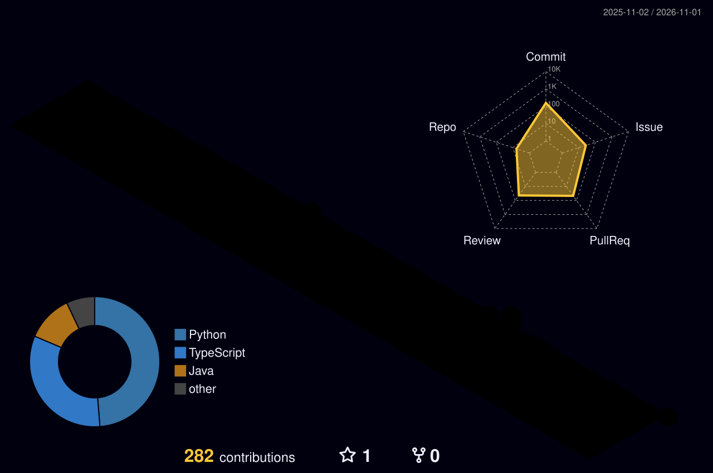

# Hi, I'm KangminKim 👋

<!-- Typing -->

 

🎓 Hongik Univ. &nbsp;·&nbsp; 📧 <a href="mailto:kkmin801@gmail.com">kkmin801@gmail.com</a>

---

### 🛠 Tech Stack

  

---

### 🚀 Projects

| Project | Description | Stack |
|:--|:--|:--|
| [☕ DripDraw](https://github.com/kmin-k/DripDraw_Hongik) | 목표 추출 곡선과 실시간 저울 데이터를 비교해 핸드드립 재현성을 측정 | Python |
| [📸 PICDAY](https://github.com/UMC-PICDAY/PICDAY_BE) | UMC 프로젝트 PICDAY 백엔드 | TypeScript, Node.js |

---

### 🏃 Activities

| | Organization | Role |
|:--:|:--|:--|
| 🌱 | **SOPT** 39th | Server (Spring) |
| 🧭 | **UMC** (University MakeUs Challenge) 11th | Plan |
| 💻 | **UMC** (University MakeUs Challenge) 10th | Backend (Node.js) |

---

### 🌃 Contributions

  

